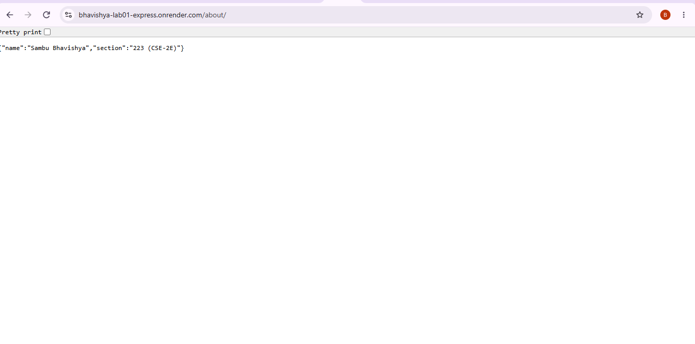
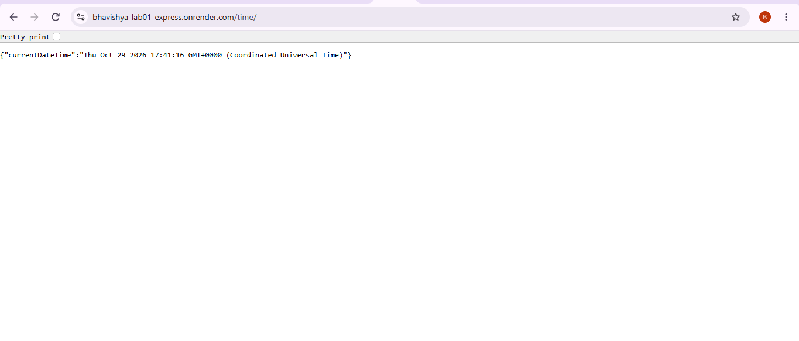

# Lab 1: Node.js and Express Server

## Student Details
- **Name:** Sambu Bhavishya
- **Registration Number:** YOUR_REGISTRATION_NUMBER
- **Section:** 223 (CSE-2E)
- **Course:** Backend Development Fundamentals
- **Faculty:** Joel Prashanth D

## Live Link
https://bhavishya-lab01-express.onrender.com

## Objective
To create a web server using Node.js and Express.js, implement GET routes, return text and JSON responses, and handle unknown routes with the correct HTTP status code.

## Technologies Used
- Node.js
- Express.js
- JavaScript
- npm

## How to Install and Run

1. Install Node.js.
2. Clone the GitHub repository.
3. Open a terminal in the `Lab-01` directory.
4. Install dependencies:

   `npm install`

5. Start the server:

   `npm start`

6. Open `http://localhost:3000` in your browser.

**Environment variables:** No environment variables are required for local development.

## Endpoints

| Method | Path | Description | Expected Status |
|---|---|---|---|
| GET | `/` | Displays the welcome message | 200 |
| GET | `/about` | Returns student name and section as JSON | 200 |
| GET | `/time` | Returns the current date and time as JSON | 200 |
| GET | `/unknown` | Handles an unknown route | 404 |

## Screenshots

Screenshots will be added in the `screenshots/` folder.

### Home Route

### About Route

### Time Route

### Unknown Route

## Problems Faced and Solutions
- Initially, the server start command failed because the project configuration was not in the correct folder.
- Created the required `package.json` inside `Lab-01`, installed Express, and configured the start script.

## Learning Outcomes
- Learned to create a Node.js project.
- Understood the difference between Node.js HTTP and Express.js.
- Implemented GET routes and JSON responses.
- Handled unknown routes using HTTP status code 404.
- Tested HTTP status codes and deployed the server online.