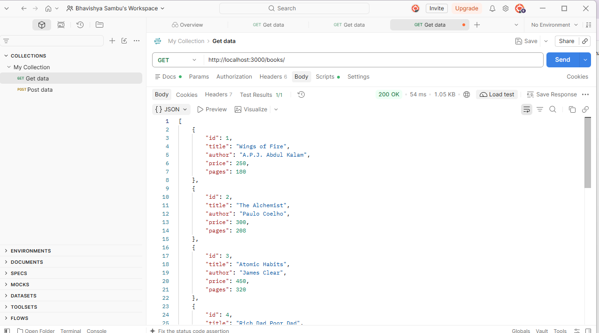
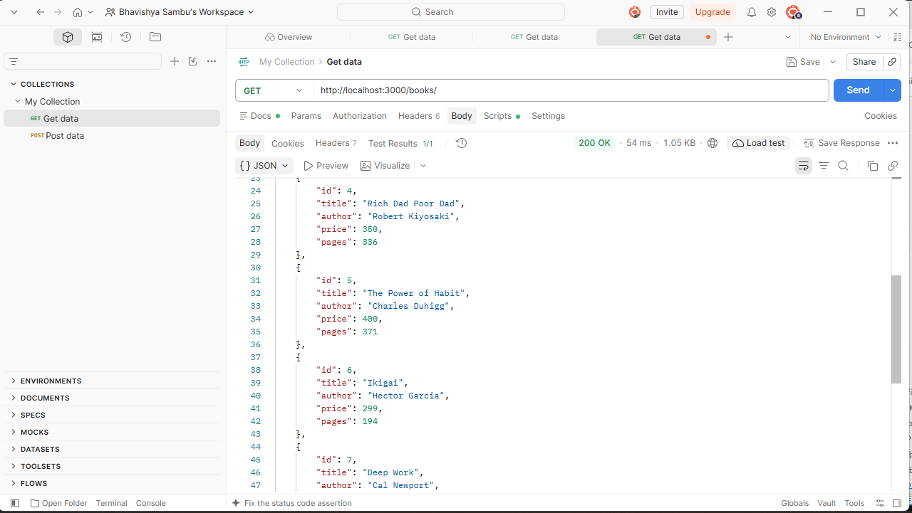
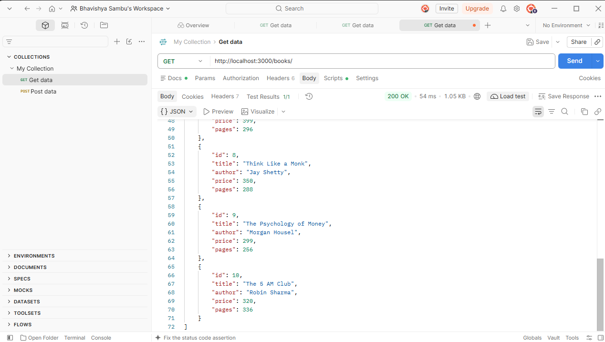
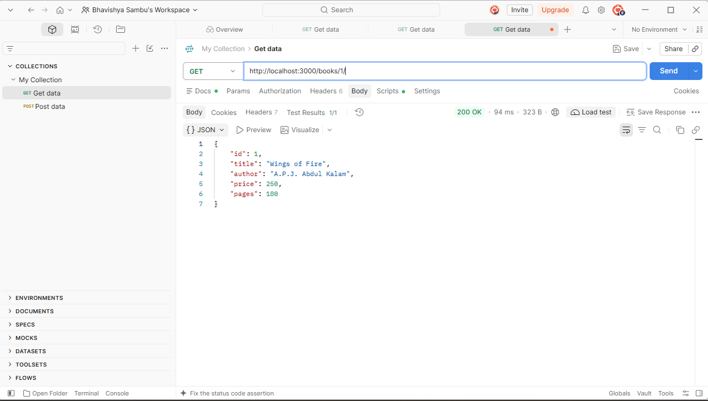
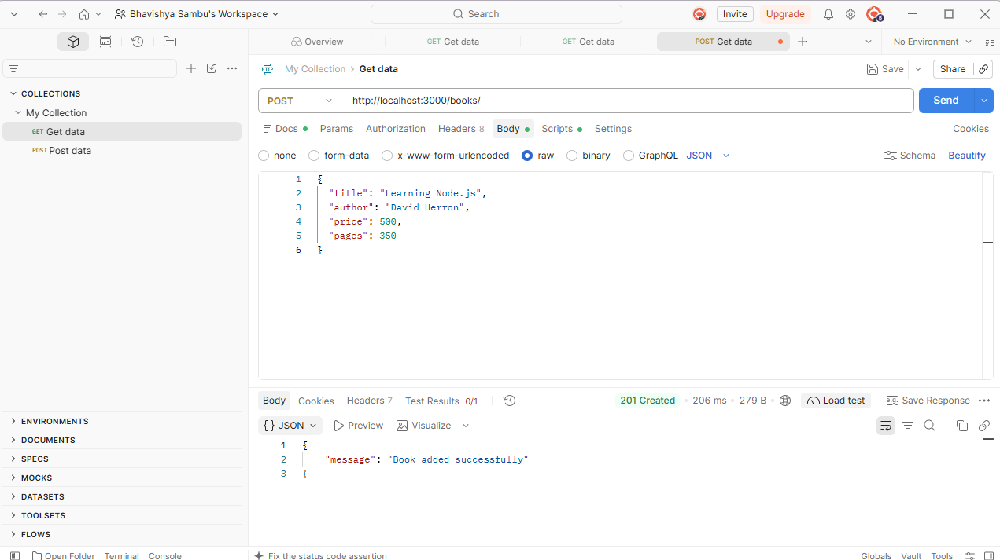
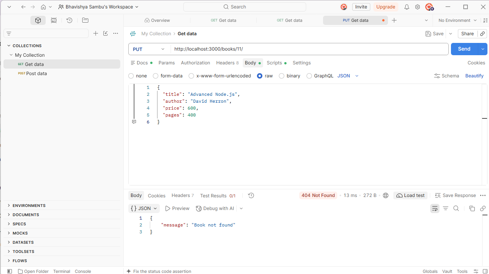
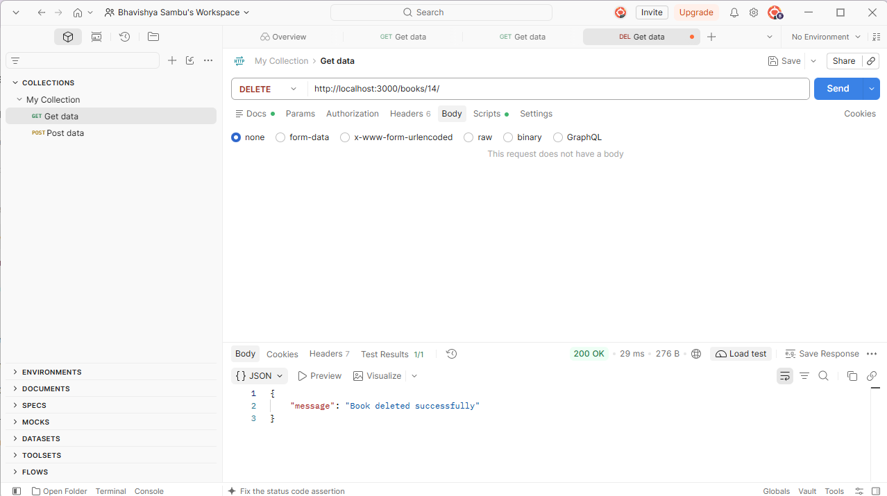
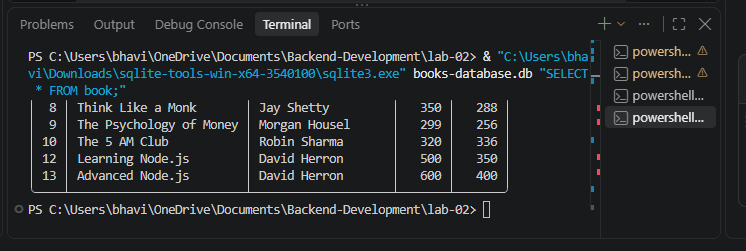

# Lab 2: SQLite Database and CRUD Routes

**Course:** Backend Development Fundamentals  
**Student Name:** Bhavishya Sambu  
**Registration Number:** 252U1R1224  
**Section:** 223 (CSE-2E)  
**Institution:** Aurora – NIAT

---

## Live Application URL

**Status:** Not deployed yet. The application is currently running locally at:

`http://localhost:3000`

## 1. Objective

To connect an Express.js server to an SQLite database and implement CRUD (Create, Read, Update, Delete) operations using HTTP methods.

## 2. Technologies Used

- Node.js
- Express.js
- SQLite
- SQLite3
- JavaScript
- Postman
- Nodemon

## 3. Project Structure

```text
lab-02/
│
├── node_modules/
├── screenshots/
├── books-database.db
├── package.json
├── package-lock.json
├── server.js
└── README.md
```

## 4. Database Structure

**Database Name:** books-database.db  
**Table Name:** book

| Column | Data Type | Description |
|---|---|---|
| id | INTEGER | Primary key |
| title | TEXT | Book title |
| author | TEXT | Author name |
| price | INTEGER | Book price |
| pages | INTEGER | Number of pages |

The database contains 10 sample book records.

## 5. Installation and Execution

### Install dependencies

```bash
npm install
```

### Start the development server

```bash
npm run dev
```

### Application URL

```text
http://localhost:3000
```

## 6. API Endpoints

| HTTP Method | Endpoint | Description |
|---|---|---|
| GET | `/books/` | Retrieve all books |
| GET | `/books/:bookId/` | Retrieve a book by ID |
| POST | `/books/` | Add a new book |
| PUT | `/books/:bookId/` | Update an existing book |
| DELETE | `/books/:bookId/` | Delete a book |

## 7. API Testing

All five API endpoints were tested using Postman.

- GET all books – Successfully retrieved all records.
- GET book by ID – Successfully retrieved a specific book.
- POST – Successfully inserted a new book.
- PUT – Successfully updated an existing book.
- DELETE – Successfully deleted a book.

SQLite CLI was used to verify database records after CRUD operations.

## 8. Screenshots
### GET All Books




### GET Book by ID


### POST Book


### PUT Book


### DELETE Book


### SQLite Verification


## 9. Learning Outcomes

- Learned how to connect Node.js and Express.js with SQLite.
- Understood database creation and table structure.
- Implemented CRUD operations using HTTP methods.
- Practiced parameterized SQL queries using `?` placeholders.
- Tested API endpoints using Postman.
- Understood asynchronous database operations using async/await.

## 10. Conclusion

Successfully developed an Express.js application connected to an SQLite database. Implemented and tested all five CRUD endpoints and verified database changes using SQLite CLI.